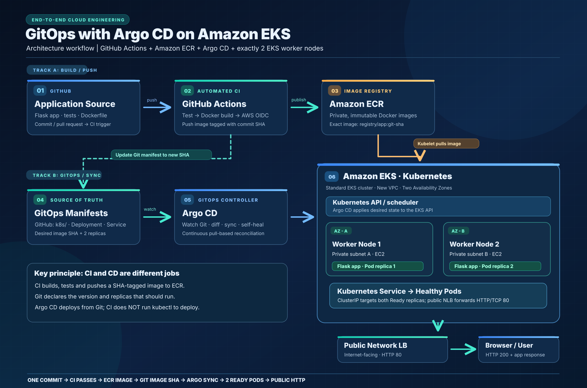

# GitOps with Argo CD on Amazon EKS

<p align="center"><strong>From a Git commit to a healthy, publicly reachable Kubernetes application.</strong></p>



[](https://github.com/HafizMohammadSunasara/aws-eks-argocd-gitops/actions)


> **Status:** This repository is an executable **starter implementation**. Flask code, unit tests, GitHub Actions, Dockerfile and Kubernetes/Argo CD manifests are included. **No EKS cluster, ECR image, public URL or successful cloud deployment is claimed yet.** Infrastructure and AWS identity configuration come in later phases.

## Why this project exists

Traditional CI/CD often combines building an image and deploying it directly to a cluster. This project deliberately separates them:

| Build side (CI) | Deployment side (GitOps CD) |
| --- | --- |
| A GitHub change runs tests and builds Docker. | Kubernetes manifests in Git declare the desired image and replica count. |
| GitHub Actions publishes an immutable SHA-tagged image to Amazon ECR. | Argo CD observes Git and reconciles the EKS cluster. |
| Automation proposes an image-update pull request for review. | Merging a GitOps change becomes the deployment trigger after Argo CD sync is enabled. |

This makes deployment history reviewable, reduces ad-hoc cluster changes, and enables Git-based rollback and drift detection.

## Target architecture

- **Source:** GitHub application code and Kustomize configuration in this repo.
- **CI:** GitHub Actions tests, builds the image, uses AWS OIDC (temporary credentials), publishes to ECR, and opens an image-promotion PR.
- **Registry:** Private Amazon ECR repository with commit-SHA tags.
- **GitOps:** Self-managed Argo CD running in a standard Amazon EKS cluster.
- **Compute:** A managed EKS node group initially sized for **two EC2 worker nodes** across two Availability Zones.
- **Workload:** Two desired Flask Pod replicas behind a ClusterIP Service. Replica spreading is preferred, but not guaranteed by the lab constraints.
- **Exposure (later):** Optional internet-facing Network Load Balancer after AWS Load Balancer Controller and subnet routing are verified.

## Repo map

| Path | What it does |
| --- | --- |
| `app/` | Flask web UI and health/readiness endpoints. |
| `tests/` | Verifies the app and the image-update helper. |
| `Dockerfile` / `requirements.txt` | Container build, dependencies and non-root runtime. |
| `.github/workflows/pipeline.yml` | CI tests + gated ECR build + GitOps promotion PR (after AWS configuration). |
| `k8s/base/` | Reusable Deployment (2 Pods) and private ClusterIP Service. |
| `k8s/overlays/dev/` | Dev namespace and ECR image/tag source of truth. |
| `k8s/optional/` | **Not initially applied:** public NLB Service after controller setup. |
| `argocd/application-dev.yaml` | Registers the dev overlay with self-managed Argo CD; initial sync is manual. |
| `scripts/` | Repository YAML checks and immutable-image promotion helper. |
| `docs/` | First-push guide, file explanations, AWS/Argo CD path, debugging, cleanup. |
| `assets/architecture.svg` | Editable architecture workflow diagram. |

**If you are new:** Start with **[docs/00-FIRST-PUSH.md](docs/00-FIRST-PUSH.md)**, then **[docs/FILE-GUIDE.md](docs/FILE-GUIDE.md)**. Do not create paid AWS resources until you understand the cost and security steps.

## Local quick start

Requires Python 3.12+ (and Docker only for the container step).

```bash
python -m venv .venv
# Linux/macOS: source .venv/bin/activate
# Windows PowerShell: .venv\Scripts\Activate.ps1
python -m pip install -r requirements-dev.txt
python -m unittest discover -s tests -v
python scripts/validate_manifests.py
python -m flask --app app run --host 127.0.0.1 --port 8080
```

Visit `http://127.0.0.1:8080/` and `http://127.0.0.1:8080/healthz`.

Optional Docker test:

```bash
docker build -t gitops-flask:local .
docker run --rm -p 8080:8080 gitops-flask:local
```

## How the first GitHub push behaves

1. GitHub Actions runs Python tests, YAML checks and a Docker build.
2. **Publishing to ECR is intentionally skipped** until you configure repository variables `AWS_REGION`, `AWS_ROLE_ARN`, `ECR_REPOSITORY` and the AWS IAM OIDC trust/policy. These are settings, *not* AWS access keys.
3. Once configured, a successful trusted `main` push builds/pushes ECR and opens a PR to update the image SHA in `k8s/overlays/dev/kustomization.yaml`.
4. After merging that PR, Argo CD can deploy the desired Git revision once EKS/Argo CD are ready.

Never store access keys, passwords, kubeconfig, `.env`, or AWS secrets in Git. See [docs/AWS-AND-ARGOCD-SETUP.md](docs/AWS-AND-ARGOCD-SETUP.md).

## Evidence and learning goals

When the infrastructure phase is complete, add redacted screenshots/evidence of: green tests, ECR SHA image, 2 Ready nodes, Argo CD Healthy/Synced, two Ready Pods, NLB external hostname and HTTP 200. Also demonstrate a Git-only rollback and safe drift recovery.

For current limitations, failure patterns, and cleanup see [docs/TROUBLESHOOTING.md](docs/TROUBLESHOOTING.md) and [docs/COST-AND-CLEANUP.md](docs/COST-AND-CLEANUP.md).

---

**Built as a hands-on learning and portfolio project by Hafiz Mohammad Sunasara.** MIT License. Production hardening (TLS, DNS, observability, IAM review, multi-AZ NAT, autoscaling and disaster recovery) is outside this starter's verified scope.
